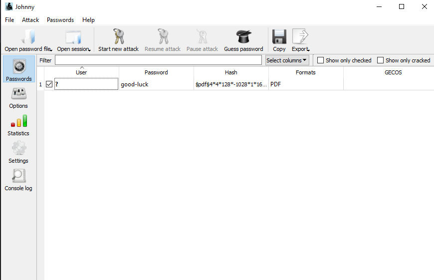
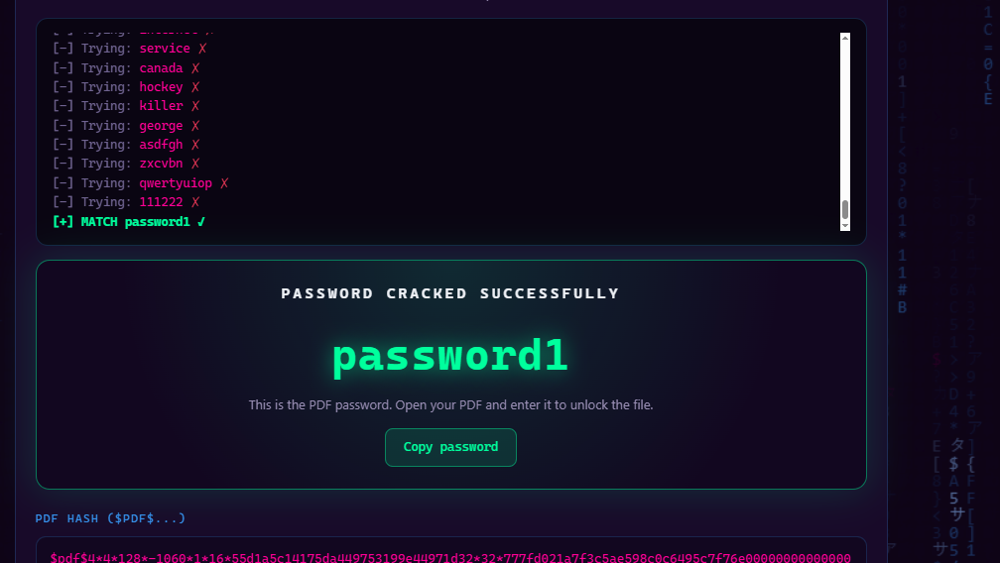
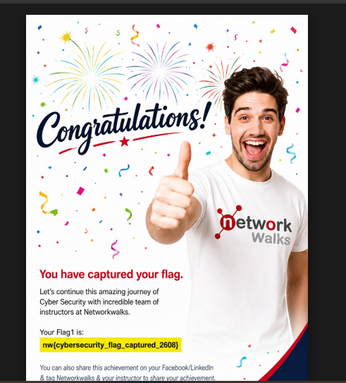

# Week 3: Password Cracking Report

## 1. Liability Disclaimer
I have performed these activities only on the systems & devices where I had secured written permission or the devices/systems that I own myself. All these materials are for education and research purpose only. Do not use anything from here to break the law.

## 2. Introduction
This report covers the password cracking lab completed for Week 3 of the Networkwalks Cybersecurity Internship. The objective was to recover the password from a password-protected PDF file (`My Locked PDF1.pdf `) using two different methods: 
1. John the Ripper (JTR) and Johnny GUI on Windows.
2. Networkwalks Hash Calculator and Password Cracker browser tools.

## 3. Tools Used
- John the Ripper (JTR): A popular open-source password cracking tool.
- Johnny: The graphical user interface (GUI) for JTR.
- Networkwalks Hash Calculator: A browser-based tool to extract hashes from files.
- Networkwalks Password Cracker: A browser-based tool to crack hashes.

## 4. Activities Performed

### 4.1 Password Cracking with John the Ripper
I downloaded and installed John the Ripper and Johnny. I extracted the hash from the locked PDF using an online hash extractor and saved it as `hash1.txt`. I then loaded this hash into Johnny and started a new attack. Johnny successfully cracked the password, which was `good-luck`. I used this password to open the PDF and confirm access.

### 4.2 Password Cracking with Networkwalks Tools
I used the Networkwalks Hash Calculator to extract the hash from the locked PDF directly in the browser. I then copied this hash into the Networkwalks Password Cracker, which successfully recovered the password: **`password1`**. This method was faster as it required no installation.

## 5. Risk Analysis / Impact
- Weak Password Vulnerability: The password `password1 and good-luck` are extremely common and was cracked instantly. In a real-world scenario, this would allow an attacker to access sensitive documents.
- **Password Storage:** Both methods demonstrated that passwords for protected files are stored as hashes. If an attacker gains access to the hash (e.g., through a data breach), they can use tools like JTR to crack weak passwords.

## 6. Recommendations
- Use Strong Passwords: Passwords should be long, complex, and not based on dictionary words.
- Enable Multi-Factor Authentication (MFA): Even if a password is cracked, MFA adds an extra layer of security.
- Regular Security Audits: Organizations should regularly test their password policies using tools like JTR to identify weak passwords before attackers do.

## 7. Conclusion
During Week 3, I learned how password cracking works from both a command-line/GUI perspective and a browser-based perspective. The exercise highlighted the importance of strong password policies and encryption. All activities were performed within the authorized scope of my own lab and Networkwalks' internship guidelines.

## 8. Evidence
### John the Ripper - Cracked Password

### Networkwalks Password Cracker - Cracked Password

### PDF Flag 1

### PDF Flag 2

